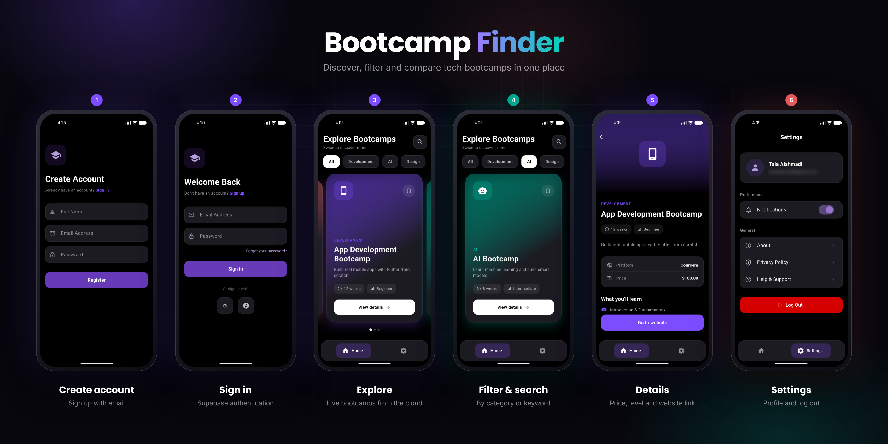

# Bootcamp Finder

A Flutter app that brings training bootcamps from different platforms into one place, so you can browse, filter, and compare them, then jump to the original website to register.

## The Problem

Bootcamps are scattered across many websites, and finding one that fits (duration, level, price) takes time. Bootcamp Finder shows them in a single screen with category filters and search.

## Target Audience

TODO:Students and graduates looking for bootcamps in programming, AI, and design, who want to compare options in one place instead of searching many websites.

## Features

- Sign up, log in, and log out with Supabase Auth; the app remembers the user after it is closed
- Bootcamps are loaded from a Supabase database table
- Category filter (Development / AI / Design) and search by name or description
- Details page for each bootcamp (duration, level, platform, price)
- A button that opens the bootcamp's page on its original website
- Loading and error states, with a Retry button
- Local caching: the app opens instantly with the last saved bootcamps, even without internet

## Tech Stack

| Area | Used |
|---|---|
| Framework | Flutter / Dart |
| Backend (auth and database) | Supabase |
| State management | Cubit (`flutter_bloc`) |
| Local storage | `shared_preferences` |
| Packages | `card_swiper`, `google_nav_bar`, `url_launcher` |

## Project Structure

```
lib/
├── main.dart
├── model/       Bootcamp data model (fromJson / toJson)
├── cubit/       BootcampCubit and BootcampState
├── services/    Supabase client, auth, bootcamps, cache
└── UI/          Screens (login, sign up, home, details, settings)
```

## How It Works

1. `BootcampCubit` loads the saved copy first (if any) and shows it right away.
2. It then fetches the latest bootcamps from Supabase through `BootcampService`.
3. On success it updates the screen and saves a fresh copy locally.
4. If the request fails and a saved copy exists, the saved copy stays on screen. If there is nothing saved, an error state with Retry is shown.

## Getting Started

1. Clone the repository:
```
   git clone https://github.com/tala0alahmadi/bootcamp_finder.git
```
2. Install dependencies:
```
   flutter pub get
```
3. Create your own Supabase project, then put its URL and **publishable** key in `lib/services/supabase_client.dart`. Never use a secret or `service_role` key in the app.
4. Create a `bootcamps` table with these columns: `name`, `category`, `weeks`, `level`, `description`, `source`, `url`, `price`. Enable Row Level Security and add a read-only `SELECT` policy.
5. Create a `profiles` table with an `id` column (uuid, references `auth.users.id`). Enable Row Level Security and add policies so each user can access only their own row.
6. For development, email confirmation can be turned off in Supabase Auth settings.
7. Run the app:
```
   flutter run
```

## Challenges and How I Solved Them

- **"Anonymous sign-ins are disabled" on sign up:** the form fields had no `controller`, so empty values were sent to Supabase. Adding controllers to the fields fixed it.
- **"Email not confirmed" on login:** Supabase requires email confirmation by default. I confirmed the user and disabled confirmation for development.
- **The AI category showed "No bootcamps found":** the category text in the database contained a hidden tab character. I trimmed the values when parsing and made the comparison case-insensitive.
- **The bootcamps table returned an empty list:** Row Level Security was enabled without a policy. Adding a read-only `SELECT` policy fixed it.
- **The emulator kept closing:** two conflicting Android environment variables made the Gradle build fail. Removing one of them fixed the build.
- **Database data does not contain icons or colors:** the `Bootcamp` model computes the icon and color from the category.

## AI Tools Used

- Claude: explained concepts, and helped debug errors.


## Known Limitations and Future Improvements

- Bookmark button to save favorite bootcamps
- Password reset ("Forgot your password")
- Google and Facebook sign-in
- Working About, Privacy Policy, and Help items in Settings
- Real curriculum for each bootcamp instead of the generic list
- An "Offline" indicator when cached data is shown

## Screenshots


